 <h1 data-importer="text" align="center">Hello! I'm Aline.  Welcome to my crib.  </h1>

<h2 data-importer="text" align="center">Software Engineering student | Developer in progress</h2>

###

  
  

###

  
  
  
  
  
  
  
  
  
  
  
  
  
  
  
  
  

###

  
  

###

<picture data-importer="pacman">
  <source
    media="(prefers-color-scheme: dark)"
    srcset="https://raw.githubusercontent.com/aileesant/aileesant/pacman-output/pacman-contribution-graph-dark.svg?game=pacman">

  <source
    media="(prefers-color-scheme: light)"
    srcset="https://raw.githubusercontent.com/aileesant/aileesant/pacman-output/pacman-contribution-graph.svg?game=pacman">

  
</picture>

###
